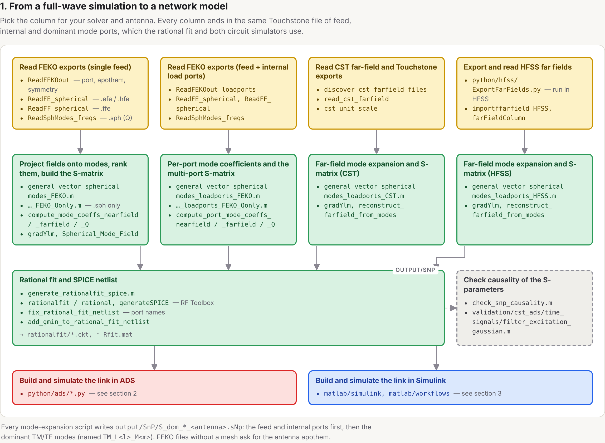
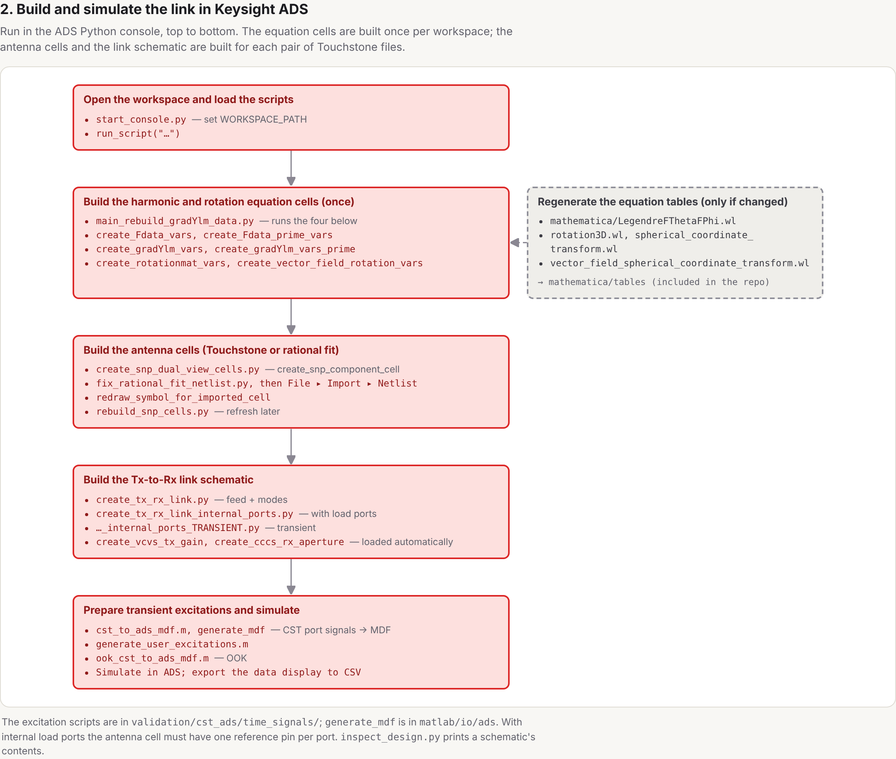
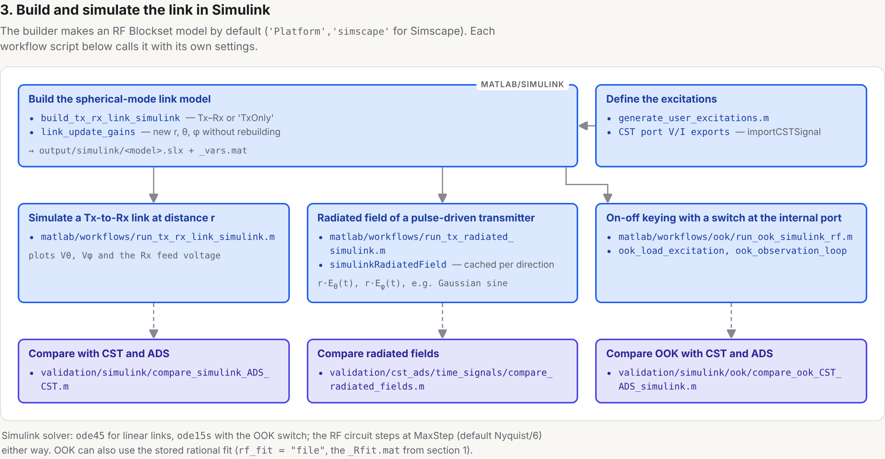
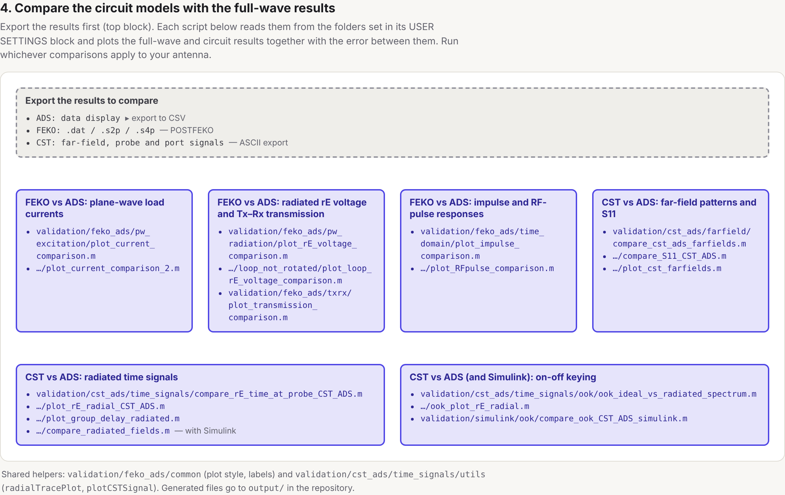

# Spherical-mode network models for antennas

A MATLAB/Python toolbox that turns a full-wave antenna simulation into a **circuit model of the
antenna and the space around it**. The radiated field is expanded in TE/TM spherical modes,
and each dominant mode becomes a port of an N-port S-parameter network. The antenna feed and any
internal load ports (switches, varactors, loads) stay as ordinary circuit ports. The result is a
Touchstone file that a circuit simulator can use like any other component. It reproduces the
antenna's input behaviour and its radiated field in every direction, in both the frequency and
time domains.

This lets you study effects that are hard to set up in a field solver but easy in a circuit
simulator: time-varying loads, nonlinear drivers, transmitter–receiver links at arbitrary
distances and orientations, and arbitrary excitation waveforms. Each run takes seconds instead
of a full-wave re-simulation. The toolbox was developed for the paper *Spherical-Mode Network
Modeling of Antennas: Applications to Direct Antenna Modulation and Ultra-Wideband
Communications* (see [Citing](#citing)).

### What it does

- **Imports full-wave results** from Altair FEKO (near fields, far fields or spherical-mode Q
  coefficients), CST Studio Suite and Ansys HFSS (far fields per port).
- **Extracts spherical-mode coefficients** by inner-product integration over the sphere. It
  ranks the (l, m, TE/TM) modes by how much power each couples to the feed and keeps the dominant
  ones.
- **Builds the spherical-mode network** for single-port antennas, or multi-port antennas with
  internal load ports. It also compares the modal wave impedances with their Chu
  equivalent ladder circuits.
- **Exports to circuit simulators**: Touchstone `.sNp`, rational fits with SPICE netlists, Python
  scripts that build the Tx–Rx link schematics in **Keysight ADS**, and a builder for the same
  link in **Simulink** (RF Blockset by default, Simscape Electrical optional).
- **Applications included**: on–off-keyed **direct antenna modulation** (a switch on an internal
  load port, driven in the time domain) and **ultra-wideband** pulse transmission (a
  Gaussian-modulated sine) with the radiated field computed in any direction.
- **Validates itself**: scripts compare the circuit models with the full-wave results (input
  impedance, far fields, time-domain radiated fields and OOK waveforms), and regression tests
  cover the special functions, harmonics, rotations and mode extraction.

Typical flow:

```
FEKO / CST / HFSS export ─► spherical-mode expansion ─► S-parameter network (.sNp)
                                                          ├─► rational fit ─► SPICE
                                                          ├─► Keysight ADS Tx–Rx link
                                                          └─► Simulink Tx–Rx link / Tx radiated field
```

## Workflow

Which scripts and functions to use at each step. Colours: yellow = import from the EM solver,
green = spherical-mode expansion, S-parameters and rational-fit SPICE, red = ADS,
blue = Simulink, indigo = comparison with the full-wave results, dashed grey = optional.
The same diagrams as one page: [`docs/workflows/workflow_guide.html`](docs/workflows/workflow_guide.html)
(open it in a browser).









## Repository layout

For an interactive version, open [`docs/repo_tree.html`](docs/repo_tree.html) in a browser (download it first; GitHub shows HTML files as source). It colour-codes every file by workflow stage, using the colours of the block diagrams, and has a search box and per-stage filters.

| Folder | Contents |
|---|---|
| `matlab/workflows/` | Entry-point scripts: mode extraction for FEKO (single port, load ports, Q-only), CST and HFSS; modal impedances; rational fitting; Simulink link, pulse-driven Tx and OOK (`ook/`) simulations |
| `matlab/sphmodes/` | Spherical harmonics, vector spherical waves, mode-coefficient extraction (`mode_expansion/`) |
| `matlab/bessel_functions/` | Spherical Bessel/Hankel and Riccati–Bessel functions and derivatives |
| `matlab/simulink/` | Simulink Tx–Rx link builder (RF Blockset or Simscape) and Tx radiated-field simulation |
| `matlab/rotation/` | Vector-field and coordinate rotations |
| `matlab/io/` | Readers for FEKO (`.out`, `.efe`, `.hfe`, `.ffe`, `.sph`, `.cfx`), TICRA `.sph`, HFSS and CST exports (fields, port and time signals); ADS MDF writer and CSV readers (`io/ads`) |
| `matlab/snp/` | Touchstone utilities, causality checks, rational-fit netlist post-processing |
| `matlab/analytic/bicon/` | Analytic biconical-antenna model, incl. conical harmonics (`conical/`) |
| `matlab/plotting/` | Field comparison plots |
| `python/ads/` | Keysight ADS Python-console scripts that build the circuit cells and link schematics |
| `python/hfss/` | HFSS script (`ExportFarFields.py`) that exports the per-port far fields read by the HFSS workflow |
| `mathematica/` | Wolfram Language scripts generating the equation tables in `mathematica/tables/` |
| `validation/` | Comparisons and plots: FEKO vs ADS, CST vs ADS (incl. time domain and OOK), Simulink vs CST/ADS |
| `docs/` | Workflow block diagrams (`docs/workflows`) and an interactive repository map (`docs/repo_tree.html`) |
| `tests/` | Verification scripts for the Bessel functions, harmonics, rotations and mode extraction |
| `third_party/` | Code by other authors, with original attribution — see `third_party/README.md` |

## Requirements

- MATLAB (developed on R2025a) with RF Toolbox. Symbolic Math Toolbox for the analytic
  biconical scripts; Simulink and RF Blockset for `matlab/simulink` and `validation/simulink` (Simscape Electrical only for
  the optional Simscape variant).
- Keysight ADS with its Python design-environment API, for `python/ads`.
- Ansys HFSS (Electronics Desktop) to export far fields with `python/hfss/ExportFarFields.py`, for the HFSS workflow.
- Wolfram Mathematica only to regenerate `mathematica/tables` (generated tables are included).
- Simulation data from FEKO, CST or HFSS. No simulation data is included in this repository.

## Getting started

1. Clone the repository and, in MATLAB, run `setup` from the repository root (the workflow
   scripts also call it themselves).
2. Open a workflow script in `matlab/workflows/`, edit its **USER SETTINGS** block (location of
   your simulation exports, antenna name, number of modes) and run it. Touchstone files are
   written to `output/SnP/`.
3. Optionally run `generate_rationalfit_spice.m` to produce SPICE netlists.
4. In the ADS Python console, run `python/ads/start_console.py` (see `python/ads/README.md`)
   and build the cells and link schematics.

All paths other than those in the USER SETTINGS blocks are relative to the repository, and all
generated files go to `output/`, which is not tracked by git.

## Citing

If you use this toolbox, please cite the associated paper (see `CITATION.cff`):

D. Schwartz, "Spherical-Mode Network Modeling of Antennas: Applications to Direct Antenna
Modulation and Ultra-Wideband Communications" (not yet published; the reference will be
completed on publication).

## Licence

MIT — see `LICENSE`. Files in `third_party/` keep their own licences.
